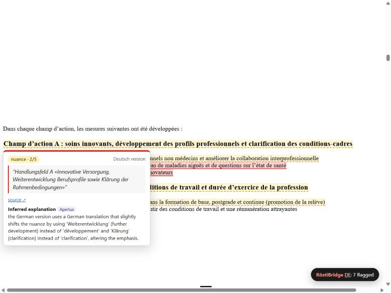
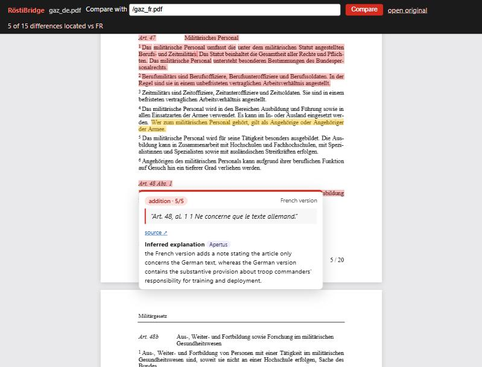

# RöstiBridge

**Hack Apertus Online · Track 2A Academia Challenges · UZH: Detecting Cross-Lingual Semantic Differences in Swiss Government Websites**

RöstiBridge is a Firefox extension that shows you where the language versions of an official Swiss page do not say the same thing. It also includes the benchmark pipeline that measures the same Apertus prompt on SwissGov-RSD ([Wastl et al., 2025, arXiv:2512.07538](https://arxiv.org/abs/2512.07538)).

| | |
|---|---|
|  |  |
| bag.admin.ch (FR) compared with its German page | Federal consultation PDF (DE) compared with the French PDF |

## What it does

1. **Swiss government pages (federal and cantonal), in any language version.** The extension finds the same page in the reference language and asks Apertus for meaning differences. Passages that may mean something different are highlighted.
   - Federal sites (`*.admin.ch`, `ch.ch`, `parlament.ch`, `fedlex`, …): the page is compared with French and German (whichever it is not in).
   - Bilingual cantons (BE, FR, VS, GR): the page is compared with the other official language. Monolingual cantons: the page is compared with the canton's language (for example, an English page on `zh.ch` is compared with German).
   - The counterpart page is found through `hreflang`, the language switcher or `/de/`↔`/fr/` URLs. On the new admin.ch CMS, where page slugs are translated and the switcher only works in JavaScript, Apertus matches the page path against the other language's site menu (for example `/fr/soins-palliatifs` → `/de/palliative-care`).
2. **Hover a highlight** to see:
   - the excerpt from the other language version, as a citation with a source link;
   - below it, an *inferred explanation* by Apertus of what differs and why it matters.
3. **RTS articles and videos.** A bar under the headline links the German (SRF) coverage of the same story. Apertus translates the headline into short search queries, the extension searches srf.ch through a news RSS feed, and Apertus picks the same story or says none matches. The bar also offers a Play SRF search link for videos. Differences between the RTS and SRF titles and text are highlighted the same way.
4. **Parliamentary PDFs opened from an official site** open in RöstiBridge's own pdf.js viewer with a text layer that can be highlighted. The other-language PDF is found in one of two ways:
   - by swapping the language in the URL (Fedlex, `/de/`↔`/fr/`, `_d.pdf`↔`_f.pdf`);
   - for parlament.ch, where each language's file has a translated name, by looking up the document's affair in the **OpenParlData API** and letting Apertus pick the translated sibling document.

Everything runs against an OpenAI-compatible endpoint (default: CSCS-hosted `swiss-ai/Apertus-v1.5-70B`; the 8B model or an on-prem vLLM endpoint can be set in the options).

## Install the extension (Firefox)

1. `about:debugging` → *This Firefox* → *Load Temporary Add-on…* → pick `src/extension/manifest.json`. Alternatively, use `dist/roestibridge-0.1.0.xpi` in Firefox Developer Edition or Nightly with `xpinstall.signatures.required=false`.
2. Click the red RöstiBridge toolbar icon (or the pill on a page), paste your Apertus API key and save.
   - The key is kept in `browser.storage.local` and is used only in the background script, never in page scripts.
3. Open any official page, for example https://www.bag.admin.ch/fr/agenda-soins-de-base.

Developer loop: `npx web-ext run --source-dir src/extension`.

## Benchmark (SwissGov-RSD)

```bash
make run          # Docker: unit tests, re-score shipped dev outputs, number baseline, rebuild test predictions
                  # + a live Apertus run on a small dev sample when LLM_API_KEY is set
make predict-test # full test-split prediction (168 docs x 3 samples) with the frozen prompt
```

Environment: `LLM_NAME`, `LLM_BASE_URL`, `LLM_API_KEY` (as in the template). `LIVE_LIMIT` sets the number of documents per language for the live run (default 5).

**Submitted predictions:** `predictions/test_70b_n3/predictions_{de,fr,it}.jsonl`. They use the `EncoderPrediction` schema of the official `evaluation/utils.py` (`id, text_a, text_b, labels_a, labels_b`). Raw Apertus outputs, with token usage, are in `raw_*.jsonl` next to them.

| Dev subset (40 docs × 3 pairs), token-level Spearman | DE | FR | IT | macro |
|---|---|---|---|---|
| Number-mismatch baseline (no model) | 0.102 | 0.068 | 0.080 | 0.083 |
| Apertus-70B, 1 sample, raw spans | 0.136 | 0.056 | 0.096 | 0.096 |
| + severity ≥ 2, omissions = 1.0, number prior | 0.159 | 0.074 | 0.104 | 0.112 |
| **+ 3-sample self-consistency (submitted)** | **0.191** | **0.077** | **0.125** | **0.131** |

The test labels were never read: `evaluate --split test` refuses to run. See [technical_report.md](technical_report.md) for the method, ablations and limitations.

## Layout

```
src/extension/      Firefox extension (MV2): background.js, content/{gov,rts,highlight,extract}.js, pdf/ viewer, options/
src/extension/shared/prompt.json   the ONE prompt used by both the extension and the benchmark
src/roestibridge/   Python pipeline: llm.py (stdlib client), rsd.py (prompt -> spans -> token scores), metrics.py, cli.py
predictions/        dev/test outputs (raw model answers + token labels)
tests/              unit tests (projection, metric parity, parsing, manifest integrity)
```
